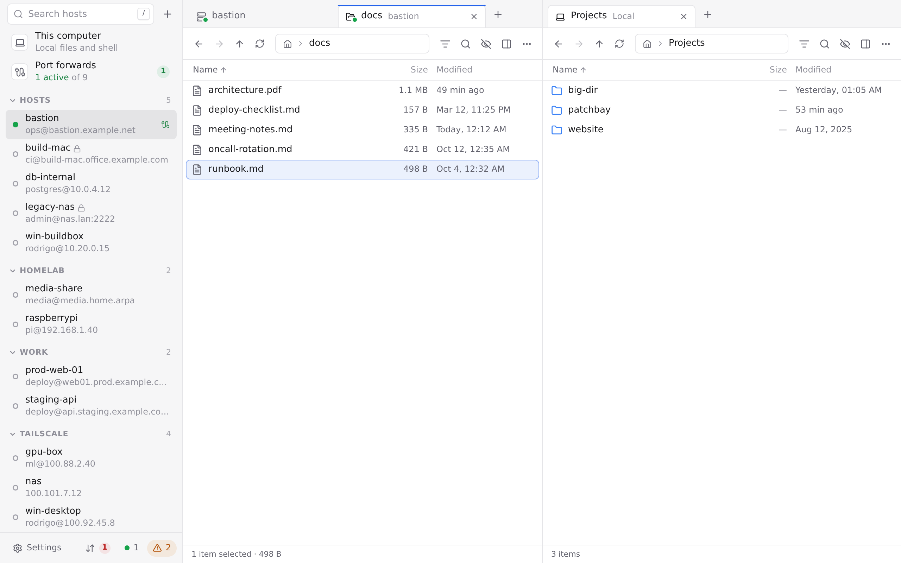

<h1 align="center">Patchbay</h1>

  A friendly desktop app for working with your machines over SSH. 
  Browse and transfer files, forward ports and open terminals, all in one window.

  <a href="https://github.com/rodrigohpalmeirim/patchbay/releases/latest"><b>Download</b></a>
  ·
  <a href="#features">Features</a>
  ·
  <a href="#install">Install</a>

  <picture>
    <source media="(prefers-color-scheme: dark)" srcset="assets/screenshot-dark.png">
    
  </picture>

Patchbay works with the SSH setup you already have. Your hosts come straight from
`~/.ssh/config`, your keys and agent just work, and there's nothing to install on the
servers. It runs on Windows, macOS and Linux, and it's free and open source.

## Features

- **Your SSH config is your host list.** Patchbay reads `~/.ssh/config` (with `Include`,
  patterns and `ProxyJump`), so it always agrees with `ssh`. Adding or editing a host
  changes only that host's lines, keeping your comments and formatting. Sort hosts into
  groups and tag them.
- **Files.** Tabs, side-by-side panes and drag and drop, between your computer and a server
  or between two servers. Transfers can be paused and resumed. Preview files, search, change
  permissions, or edit a remote file in your own editor and have it upload when you save.
  Works on SFTP-only servers too.
- **Terminals.** Tabs and splits for remote and local shells, "open terminal here" from
  the file browser, and saved snippets.
- **Port forwarding.** Local, remote and SOCKS forwards, saved as named rules that can start
  with the app and reconnect on their own. They keep running from the system tray.
- **Tailscale.** Devices on your tailnet show up automatically, and Tailscale SSH just works.
- **Sign-in and security.** Key files, the SSH agent (including Pageant and Windows
  OpenSSH), passwords and two-factor prompts. Passwords can be saved in your system
  keychain. Host keys are checked against your `known_hosts`, and you're warned loudly if
  one changes.
- **It picks up where you left off.** Your tabs come back when you restart, and the app
  updates itself.

## Install

Download the latest version from the
[releases page](https://github.com/rodrigohpalmeirim/patchbay/releases/latest).

| System | Download |
|---|---|
| Windows 10/11 | `Patchbay_<version>_x64-setup.exe` (or the `.msi`) |
| macOS, Apple Silicon | `Patchbay_<version>_aarch64.dmg` |
| macOS, Intel | `Patchbay_<version>_x64.dmg` |
| Linux | `.AppImage`, `.deb` (Debian, Ubuntu) or `.rpm` (Fedora, openSUSE) |

Once installed, Patchbay keeps itself up to date.

The builds aren't code-signed yet, so the first launch needs one extra step:

- **Windows:** if SmartScreen says "Windows protected your PC", click **More info**, then
  **Run anyway**.
- **macOS:** open the app once, then go to **System Settings → Privacy & Security** and
  click **Open Anyway**. Or run `xattr -dr com.apple.quarantine /Applications/Patchbay.app`.
- **Linux:** install the package with `sudo apt install ./Patchbay_<version>_amd64.deb` or
  `sudo dnf install ./Patchbay-<version>-1.x86_64.rpm`, or make the AppImage executable
  (`chmod +x Patchbay_*.AppImage`) and run it.

To build Patchbay yourself, see [CONTRIBUTING.md](CONTRIBUTING.md).

## Contributing

Patchbay is young, so bug reports and ideas are very welcome. Please
[open an issue](https://github.com/rodrigohpalmeirim/patchbay/issues). To work on the code,
start with [CONTRIBUTING.md](CONTRIBUTING.md).

## License

Copyright (C) the Patchbay contributors.

Patchbay is free software: you can redistribute it and/or modify it under the terms of the
GNU General Public License as published by the Free Software Foundation, either version 3
of the License, or (at your option) any later version. See [LICENSE](LICENSE).
